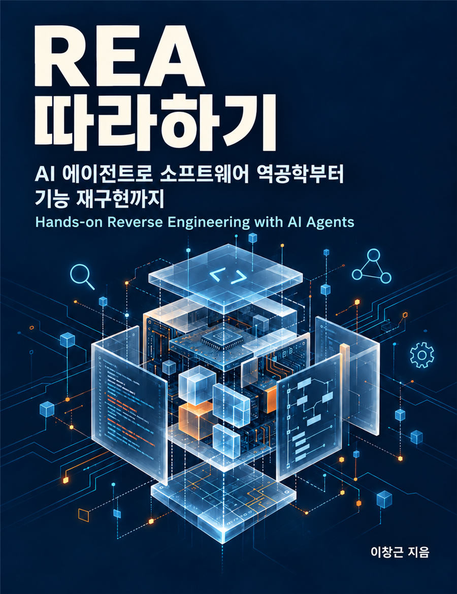

# rea-tutorial

위키독스 책 **《REA 따라하기》 — AI 에이전트로 소프트웨어 역공학부터 기능 재구현까지**의 실습 자료 저장소입니다.

- REA 공식 저장소: https://github.com/morluto/rea

## 책 구매

- YES24: https://www.yes24.com/product/goods/198291129
- 교보문고: https://ebook-product.kyobobook.co.kr/dig/epd/ebook/E000013698430
- 위키독스: https://wikidocs.net/book/21639

## 검증 기준

| 항목 | Windows (기본) | macOS |
|---|---|---|
| REA (npm rea-agents) | 6.8.0 | 6.8.0 |
| Node.js | 24.22.1 | 24.22.3 (Homebrew node@24) |
| OS | Windows 11 | macOS 26.6.2 (Apple M1) |
| Claude Code | 2.1.299 (claude-opus-5-5) | 2.1.323 (claude-opus-5-5) |
| Codex CLI | 0.162.1 | (미사용) |
| 분석 엔진 | Ghidra 12.1.4, jadx-headless-mcp 0.7.1, JDK 21 | 같음 (Ghidra 디컴파일러는 buildNatives로 빌드) |

책의 모든 명령은 `rea-agents@6.8.0` 기준입니다(2026-11-13 재실측). 최신 버전에서는 명령이나 출력이 다를 수 있습니다.

첫판(REA 6.4.0, 2026-10-13)의 자료는 태그 [`book-rea-6.4.0`](https://github.com/ady95/rea-tutorial/tree/book-rea-6.4.0)과 브랜치 `rea-6.4.0`에 그대로 남아 있습니다.

## 실습 폴더

책은 분석 대상을 `C:/rea-labs`(macOS는 `~/rea-labs`)에 둔다고 가정합니다. 각 장 폴더의 README에 준비 방법이 있습니다.

| 장 | 폴더 | 내용 |
|---|---|---|
| 3장 | [ch03](ch03) | 에이전트 연결 시험·비교에 쓴 프롬프트 |
| 5장 | [ch05](ch05) | Electron 분석 프롬프트, 보조 스크립트, 재구현 맛보기 결과 (19/19) |
| 6장 | [ch06](ch06) | 웹 시나리오, HAR 만들기 스크립트, 프롬프트 |
| 7장 | [ch07](ch07) | .NET 예제 소스, DLL만으로 복원한 명세·재구현·비교 (33/33) |
| 8장 | [ch08](ch08) | Android 분석 환경 설정, 프롬프트 |
| 9장 | [ch09](ch09) | C 예제 소스, 실행 파일만으로 복원한 C 코드·비교 (macOS 220/220, 첫판 Windows 75/75) |
| 10장 | [ch10](ch10) | Memo Stats 앱, 요구사항·재구현·하네스·자동 테스트 (51/51), 역할 분리 실행, 변이 검증 스크립트 |

에이전트가 만든 파일은 실행 결과를 그대로 싣고 경로만 책의 기준 경로(C:/rea-labs, C:/tools, macOS는 ~/rea-labs)로 바꿨습니다.

## 주의

- 프롬프트에 대한 에이전트의 답변은 실행할 때마다 달라질 수 있습니다.
- 분석 대상 소프트웨어의 라이선스와 이용 조건을 먼저 확인하세요(책 01-6).
